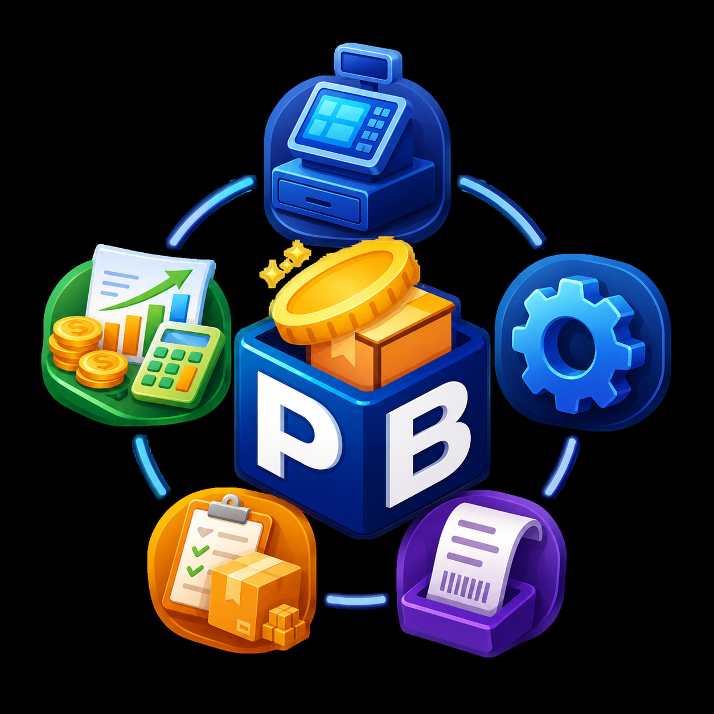
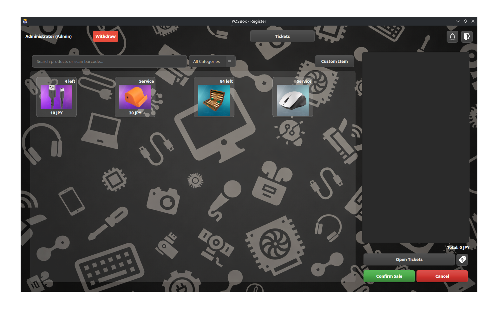
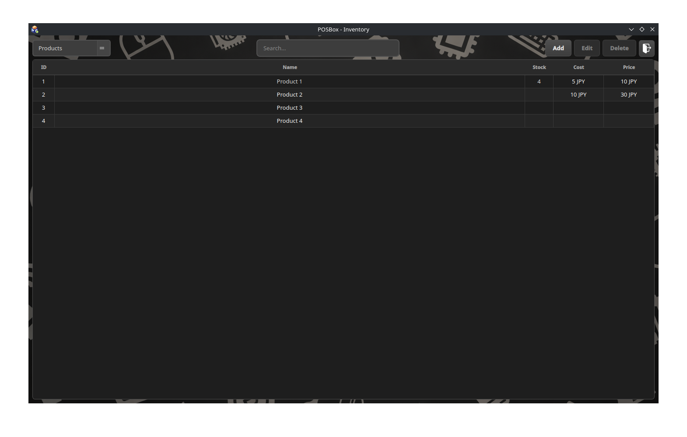
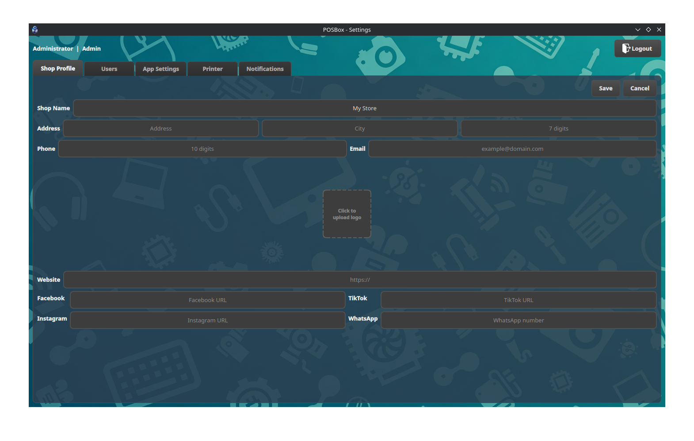
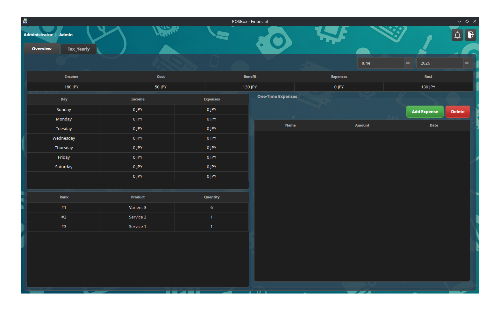

<p align="center">
  
</p>

<h1 align="center">POSBox</h1>

<p align="center">
  <b>A free, offline Point of Sale system built for small businesses.</b><br>
  No subscriptions. No cloud. No complications.
</p>

<p align="center">
  
  
  
  
</p>

---

## Why POSBox?

Most POS systems are bloated, expensive, and require an internet connection. **POSBox** is different. It's a lightweight, fully offline POS solution designed for small shops, cafés, boutiques, and local businesses that just need something that **works** — without monthly fees or complicated setups.

Install it, open it, and start selling. That's it.

---

## Screenshots

<p align="center">
  
</p>

<p align="center">
  
</p>

<p align="center">
  
</p>

<p align="center">
  
</p>

---

## Features

### Smart Register
- Visual product grid with quick one-tap add-to-cart
- Support for product **variants** (size, color, etc.)
- Built-in **discount system** — percentage or fixed amount, per-item or cart-wide
- **Custom items** on the fly — type a name and price for one-off sales
- **Open tickets** — save a cart and come back to it later
- Cash withdrawal tracking
- Real-time stock enforcement — never oversell

### Inventory Management
- Full product catalog with **images**, categories, cost, and price
- **Variant management** — create and track variants per product
- Category-based organization with CRUD operations
- **Inline stock editing** — update quantities directly from the list
- Visual stock indicators (low stock, out of stock)
- Service items (no stock tracking)
- Discount presets for quick apply

### Ticket History & Printing
- Browse all past tickets filtered by **date** or **search**
- Search by ticket number, seller name, date, or status
- **Refund** tickets — stock is automatically restored
- **Delete** tickets (admin only) — stock is automatically restored
- **Edit** tickets — opens the ticket back in the Register for modifications
- Print **A4 invoices** with company header and footer
- Print **thermal receipts** via ESC/POS (80mm and 58mm)

### Financial Reports
- **Monthly summary** — revenue, expenses, profit at a glance
- **Weekly breakdown** — see how each day of the week performed
- **Top 3 products** — your best sellers, always visible
- **One-time expenses** — track rent, utilities, or any irregular costs
- **Yearly report** — select any year and see monthly breakdowns with drill-down
- Profit/loss tracking with clear visual indicators

### Full Customization
- **24 theme combinations** — 2 color schemes (Light/Dark) x 3 font sizes x 4 backgrounds
- **9 language options** — English, French, and more coming
- **120+ countries** — auto phone prefix, postal code format, and currency
- **Dynamic currency** — formatting adapts to your selected country's currency
- Customizable shop profile with logo, address, and social media links

### Dual Printing System
- **Thermal printer support** — ESC/POS protocol over serial port (80mm & 58mm)
- **A4 invoice printing** — clean, professional invoices with customizable header/footer
- Configure printer settings directly from the Settings app

### User Management & Security
- **3 user roles** — Admin, Manager, Cashier
- **5 granular permissions** — Create Products, Edit Products, Delete Products, Delete Tickets, Create Users
- Per-user permission overrides — give a Manager extra access or restrict a Cashier
- Secure password-based authentication

### Backup & Restore
- **One-click backup** — save your entire database to any folder
- **One-click restore** — recover from a backup instantly
- Automatic path management

### Notifications
- Real-time **stock alerts** — get notified when products are running low
- **Open ticket reminders** — never forget about unfinished transactions
- Configurable notification thresholds

---

## Tech Stack

| Component | Technology |
|-----------|------------|
| Language | C++17 |
| UI Framework | Qt 6 (Widgets) |
| Database | SQLite |
| Build System | qmake |
| Printing | ESC/POS (Thermal) + QPrinter (A4) |
| IPC | Shared Memory + JSON files |
| Platforms | Linux, Windows |

---

## Installation

### Linux

1. Download the latest release from the [Releases](https://github.com/train2128/POSBox---Point-of-Sale-System/releases) page
2. Extract the archive:
   ```bash
   tar -xzf POSBox-x.x.x-linux.tar.gz
   cd POSBox
   ```
3. Make the executable runnable:
   ```bash
   chmod +x POSBox
   ```
4. Run it:
   ```bash
   ./POSBox
   ```

### Windows

1. Download the latest installer from the [Releases](https://github.com/train2128/POSBox---Point-of-Sale-System/releases) page
2. Run the `.exe` installer
3. Follow the setup wizard
4. Launch POSBox from the Start Menu or desktop shortcut

---

## Building from Source

### Prerequisites
- **Qt 6.9+** (with Widgets, SQL, SerialPort, PrintSupport modules)
- **C++17** compatible compiler (GCC 9+ or MSVC 2019+)
- **qmake** (included with Qt)

### Build Steps

```bash
# Clone the repository
git clone https://github.com/train2128/POSBox---Point-of-Sale-System.git
cd POSBox/POSBox_Commercial_Version

# Create build directory
mkdir -p build/Desktop_Qt_6_9_3-Debug
cd build/Desktop_Qt_6_9_3-Debug

# Generate Makefiles
/home/train/Qt/6.9.3/gcc_64/bin/qmake ../../../POSBox.pro -spec linux-g++ CONFIG+=debug

# Build
make -j$(nproc)
```

### Running

```bash
cd build/Desktop_Qt_6_9_3-Debug
LD_LIBRARY_PATH=./lib ./Register/Register
```

---

## Donate

[](https://buymeacoffee.com/cheriff)

---

## License

POSBox is licensed under the **GNU General Public License v3.0**. See the [LICENSE](LICENSE) file for details.

---

<p align="center">
  Built with ❤️ for small businesses everywhere.
</p>
